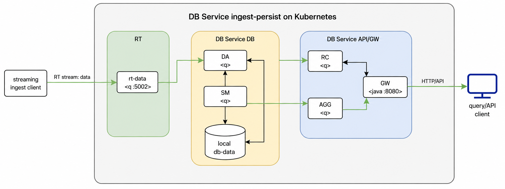
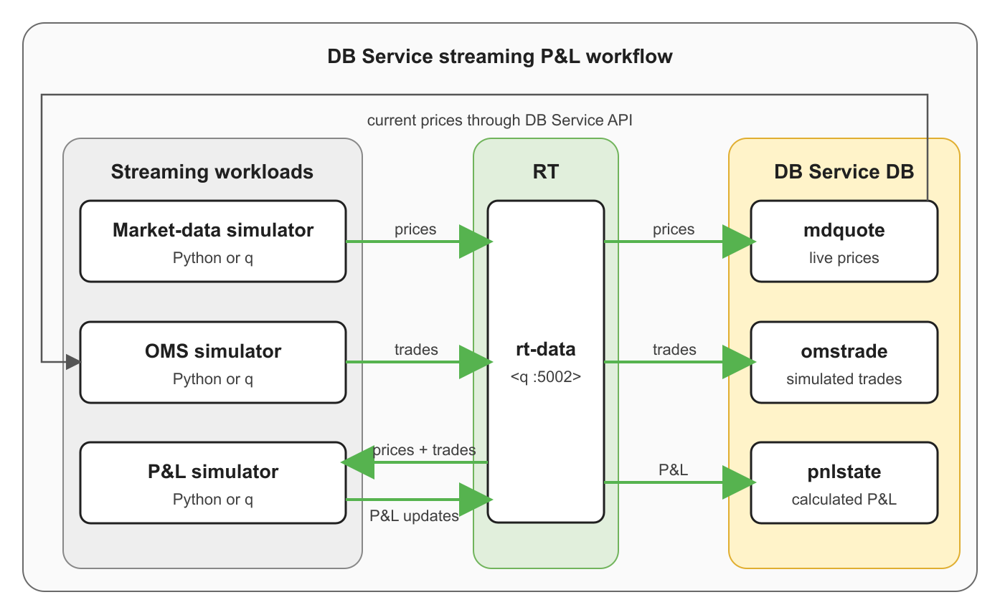

# DB Service: Single-database deployment on Kubernetes

<a id="overview"></a>

This reference architecture deploys a single DB Service database on Minikube or an existing Kubernetes cluster. The deployment includes the database components, Reliable Transport (RT) for streaming data, and a shared gateway for table, import, and query APIs.

Deploy DB Service once, then [choose a workflow](#choose-a-workflow) to explore ingestion and querying. Try a small inline dataset using REST or go directly to the streaming profit-and-loss (P&L) workflow. The P&L workflow also includes an optional KX Dashboard extension.

The verification queries use REST. For API details and other clients, see [Clients and API reference](#clients-and-api-reference).

## Contents

- [Architecture](#architecture)
- [Before you begin](#before-you-begin)
- [Deploy DB Service](#deploy-db-service)
  - [Step 1: Prepare the Kubernetes cluster](#step-1-prepare-the-kubernetes-cluster)
  - [Step 2: Configure the deployment](#step-2-configure-the-deployment)
  - [Step 3: Deploy and verify DB Service](#step-3-deploy-and-verify-db-service)
  - [Step 4: Connect to the gateway](#step-4-connect-to-the-gateway)
- [Choose a workflow](#choose-a-workflow)
- [Workflow A: Import inline data using REST](#workflow-a-import-inline-data-using-rest)
- [Workflow B: Stream data and calculate P&L](#workflow-b-stream-data-and-calculate-pl)
  - [Step 1: Configure the workflow](#step-1-configure-the-workflow)
  - [Step 2: Create the streaming tables](#step-2-create-the-streaming-tables)
  - [Step 3: Build and deploy the streaming workloads](#step-3-build-and-deploy-the-streaming-workloads)
  - [Step 4: Verify prices, trades, and P&L](#step-4-verify-prices-trades-and-pl)
  - [Optional: View P&L in KX Dashboard](#optional-view-pl-in-kx-dashboard)
- [Clean up](#clean-up)
- [Reference](#reference)
  - [Clients and API reference](#clients-and-api-reference)
  - [Streaming P&L source code](#streaming-pl-source-code)
  - [Configuration and charts](#configuration-and-charts)

## Architecture

An umbrella Helm chart deploys three local subcharts:

| Chart | Purpose |
|---|---|
| `db` | Deploys the DB Service components that ingest, persist, and serve data. |
| `rt` | Deploys Reliable Transport as the streaming message bus. |
| `gw` | Deploys the gateway components that route API and query requests. |



Together, these charts deploy one DB Service database instance, a three-replica RT stream, and one gateway.

## Before you begin

### Required access

- Valid credentials for the KX image registry
- A valid KX license
- For Minikube deployments, access to Docker and local administrative privileges where host configuration changes are required
- For existing Kubernetes clusters, sufficient RBAC permissions to create and manage namespaces, secrets, workloads, services, and persistent volume claims

### Required tools

| Tool | Required for | Purpose |
|---|---|---|
| [`bash`](https://www.gnu.org/software/bash/) | All deployments | Runs the shell commands in this guide. |
| [`curl`](https://curl.se/download.html) | All deployments | Calls the DB Service APIs. |
| [`helm`](https://helm.sh/docs/intro/install/) | All deployments | Builds and deploys the umbrella chart. |
| [`kubectl`](https://kubernetes.io/docs/tasks/tools/) | All deployments | Manages Kubernetes resources and verifies the deployment. |
| [`jq`](https://jqlang.github.io/jq/download/) | All deployments | Processes JSON import and query responses. |
| [Docker](https://docs.docker.com/engine/install/) | Minikube and streaming P&L | Runs Minikube or builds the streaming P&L simulator images. |
| [Minikube](https://minikube.sigs.k8s.io/docs/start/) | Minikube only | Creates the local Kubernetes cluster. |

## Deploy DB Service

Run all commands in this guide from `referenceArchitectures/helm/single-database`. Choose Minikube or an existing Kubernetes cluster, and use the same deployment target when following a workflow.

| Target | Storage requirement | Typical use |
|---|---|---|
| Minikube | `standard`, `ReadWriteOnce` (`RWO`) | Local evaluation on one machine |
| Existing Kubernetes cluster | An RWX StorageClass, such as `sharedfiles` | Shared or production-like infrastructure |

### Step 1: Prepare the Kubernetes cluster

Select the option for your environment:

<details>
<summary>Minikube</summary>

This Minikube configuration was tested on x86_64 Ubuntu with Minikube `v1.39.0`, 6 CPUs, 16 GB of memory, and 40 GB of disk. This is a tested configuration, not a minimum specification. It uses Minikube's default `standard` StorageClass.

**Install Minikube**

If Minikube is not installed, the following commands install `v1.39.0` on x86_64 Linux. For other platforms, follow the official [Minikube installation instructions](https://minikube.sigs.k8s.io/docs/start/); these platforms have not been validated with this example.

```bash
MINIKUBE_VERSION=v1.39.0

curl -LO "https://github.com/kubernetes/minikube/releases/download/${MINIKUBE_VERSION}/minikube-linux-amd64"

sudo install minikube-linux-amd64 /usr/local/bin/minikube
rm minikube-linux-amd64

minikube version
```

**Start Minikube**

```bash
# Configure the Minikube profile and resources.
export MINIKUBE_PROFILE="${MINIKUBE_PROFILE:-db-service-refarch}"
export MINIKUBE_CPUS="${MINIKUBE_CPUS:-6}"
export MINIKUBE_MEMORY="${MINIKUBE_MEMORY:-16g}"
export MINIKUBE_DISK_SIZE="${MINIKUBE_DISK_SIZE:-40g}"

# Optional: uncomment to delete an existing profile and all of its data.
# minikube delete -p "$MINIKUBE_PROFILE"

# Ensure the Linux host has sufficient inotify capacity.
if [ "$(uname -s)" = "Linux" ]; then
  MAX_USER_INSTANCES=$(sysctl -n fs.inotify.max_user_instances)
  MAX_USER_WATCHES=$(sysctl -n fs.inotify.max_user_watches)

  if [ "$MAX_USER_INSTANCES" -lt 8192 ] || [ "$MAX_USER_WATCHES" -lt 524288 ]; then
    printf '%s\n' \
      'fs.inotify.max_user_instances=8192' \
      'fs.inotify.max_user_watches=524288' \
      | sudo tee /etc/sysctl.d/99-db-service-minikube.conf

    sudo sysctl -p /etc/sysctl.d/99-db-service-minikube.conf
  fi
fi

# Create a new profile, or resume an existing profile with its data intact.
# This does not deploy DB Service.
./setup-minikube.sh

# Verify the cluster, node, and storage class.
minikube status -p "$MINIKUBE_PROFILE"
kubectl config current-context
kubectl get nodes
kubectl get storageclass
```

</details>

<details>
<summary>Existing Kubernetes cluster</summary>

An existing cluster requires an RWX StorageClass. The supplied values use `sharedfiles`, which must already exist in the cluster. To use another StorageClass, update `db.db.idb.storageClassName` and `db.db.hdbt1.storageClassName` in `config/db-service-single-database-values.yaml`.

```bash
# Review the available contexts and select the target cluster.
kubectl config get-contexts
kubectl config use-context "<context-name>"

# Confirm the selected cluster is accessible and inspect its storage classes.
kubectl config current-context
kubectl get nodes
kubectl get storageclass
```

</details>

### Step 2: Configure the deployment

> **Terminal state:** Keep using the same terminal while deploying DB Service. Exported variables apply only to the current terminal. Each workflow explains which variables to restore when continuing in a new terminal.

Replace the registry placeholders and uncomment one license export before running the block below. For a Community Edition license, also update `kxLicenseName` as described in the comments.

Use the supplied namespace and release names for this walkthrough. The values file is configured for `db-service-single`, and some connection and cleanup commands use these names explicitly.

```bash
# Set the registry credentials and address.
export KX_USER="<registry-username>"
export KX_PASS="<registry-password>"
export KX_REGISTRY=portal.dl.kx.com

# Set the deployment names and values files.
export NAMESPACE=db-service

# The supplied values file is configured for this release name.
export RELEASE_NAME=db-service-single

export VALUESFILE=./config/db-service-single-database-values.yaml
export MINIKUBE_VALUESFILE=./config/db-service-single-database-minikube-values.yaml

# Supply the license using one of these variables.
# For a K4 license, the chart defaults to kxLicenseName: "k4.lic".
# export LIC_FILE="/path/to/k4.lic"
# export KDB_K4LICENSE_B64="<base64-encoded-K4-license>"
#
# For a Community Edition license, add kxLicenseName: "kc.lic" under
# .common_values in config/db-service-single-database-values.yaml, then set one of:
# export LIC_FILE="/path/to/kc.lic"
# export KDB_LICENSE_B64="<base64-encoded-CE-license>"

# Create the namespace, registry secret, and license secret.
./setup-secrets.sh
```

### Step 3: Deploy and verify DB Service

<details>
<summary>Minikube</summary>

```bash
# Build the local chart dependencies.
helm dependency build --skip-refresh

# Deploy DB Service using the Minikube storage overrides.
helm upgrade --install "$RELEASE_NAME" . -f "$VALUESFILE" -f "$MINIKUBE_VALUESFILE" -n "$NAMESPACE"

# Confirm that the workloads are running and the storage claims are bound.
kubectl get pods -n "$NAMESPACE"
kubectl get pvc -n "$NAMESPACE"
```

</details>

<details>
<summary>Existing Kubernetes cluster</summary>

```bash
# Build the local chart dependencies.
helm dependency build --skip-refresh

# Deploy DB Service using the existing-cluster storage configuration.
helm upgrade --install "$RELEASE_NAME" . -f "$VALUESFILE" -n "$NAMESPACE"

# Confirm that the workloads are running and the storage claims are bound.
kubectl get pods -n "$NAMESPACE"
kubectl get pvc -n "$NAMESPACE"
```

</details>

### Step 4: Connect to the gateway

The workflows use the gateway at `http://localhost:18080`. Keep the port-forward running while you use the APIs.

```bash
# Use local port 18080 to avoid conflicts with Docker Compose on port 8080.
pkill -f 'kubectl port-forward.*18080:8080' 2>/dev/null; kubectl port-forward svc/db-service-single-gw-sg 18080:8080 -n db-service &

export GW_URL="http://localhost:18080"

# Verify gateway access and list the available tables.
curl -s "$GW_URL/api/v0/tables" | jq
```

Once the workloads are running, storage claims are bound, and the gateway is accessible, continue to [Choose a workflow](#choose-a-workflow). No example data is required for these deployment checks.

<a id="workflows"></a>

## Choose a workflow

After deploying DB Service, choose the workflow that matches what you want to try. Each workflow includes its own table setup, ingestion, and verification; you do not need to run another workflow first.

| Workflow | Choose this to... |
|---|---|
| [Workflow A: Import inline data using REST](#workflow-a-import-inline-data-using-rest) | Create a table, import three JSON rows, and query a small, fixed dataset through the REST API. |
| [Workflow B: Stream data and calculate P&L](#workflow-b-stream-data-and-calculate-pl) | Run the price, trade, and P&L workloads in Python or q, then query the results. |

You can go straight to streaming P&L without creating `fxquote` or importing the inline example data. To visualize the resulting P&L data, follow the optional dashboard extension within that workflow.

<a id="workflow-1-import-inline-data"></a>
<a id="verify-the-deployment-import-inline-data"></a>

<a id="import-inline-data-using-rest"></a>

## Workflow A: Import inline data using REST

This workflow creates the `fxquote` table, imports three JSON rows, and queries the results through the REST API.

**Prerequisite:** Complete [Deploy DB Service](#deploy-db-service).

If you are continuing in a new terminal, restore the gateway URL and confirm that the gateway is accessible:

```bash
export GW_URL=http://localhost:18080

curl -s "$GW_URL/api/v0/tables" | jq
```

If the gateway check fails, repeat [Step 4: Connect to the gateway](#step-4-connect-to-the-gateway).

### Step 1: Create the `fxquote` table

```bash
curl -s -X POST "$GW_URL/api/v0/tables/fxquote" \
  -H "Accept: application/json" \
  -H "Content-Type: application/json" \
  -d '{
    "type": "partitioned",
    "prtnCol": "ts",
    "columns": [
      {"name": "trddate", "type": "date"},
      {"name": "ts", "type": "timestamp"},
      {"name": "sym", "type": "symbol"},
      {"name": "bid", "type": "float"},
      {"name": "ask", "type": "float"}
    ]
  }' | jq
```

### Step 2: Import three rows

The import request returns a job ID. Use it to check the import status, and wait for `completed` before running the queries.

```bash
IMPORT_JOB_ID=$(curl -s -X POST "$GW_URL/api/v0/imports/data" \
  -H "Accept: application/json" \
  -H "Content-Type: application/json" \
  -d '{
    "table": "fxquote",
    "data": [
      ["2026-01-21", "2026-01-21T10:00:00.000", "EURUSD", 1.16035, 1.16085],
      ["2026-01-21", "2026-01-21T10:00:01.000", "GBPUSD", 1.34040, 1.34120],
      ["2026-01-21", "2026-01-21T10:00:02.000", "USDJPY", 157.975, 158.025]
    ],
    "columnNames": ["trddate", "ts", "sym", "bid", "ask"]
  }' | jq -r '.jobId')

# Repeat until status is completed.
curl -s "$GW_URL/api/v0/imports/$IMPORT_JOB_ID" | jq
```

### Step 3: Query the imported rows

**Read the imported rows**

```bash
# Return up to five rows.
curl -s -X POST "$GW_URL/api/v0/query/simple" \
  -H "Accept: application/json" \
  -H "Content-Type: application/json" \
  -d '{
    "table": "fxquote",
    "limit": 5
  }' | jq
```

**Filter by time**

```bash
# Return rows from the first two seconds.
curl -s -X POST "$GW_URL/api/v0/query/simple" \
  -H "Accept: application/json" \
  -H "Content-Type: application/json" \
  -d '{
    "table": "fxquote",
    "startTS": "2026.01.21D10:00:00.000000000",
    "endTS": "2026.01.21D10:00:02.000000000",
    "limit": 5
  }' | jq
```

**Filter by symbol**

```bash
# Return only the EURUSD row.
curl -s -X POST "$GW_URL/api/v0/query/simple" \
  -H "Accept: application/json" \
  -H "Content-Type: application/json" \
  -d '{
    "table": "fxquote",
    "filter": [["=", "sym", "EURUSD"]],
    "limit": 5
  }' | jq
```

After a successful import into a newly created `fxquote` table, the unfiltered query should return the three example rows. The final query selects the `EURUSD` row.

<a id="workflow-2-stream-data-and-calculate-pl"></a>
<a id="optional-run-the-streaming-pl-example"></a>

<a id="stream-data-and-calculate-pl"></a>

## Workflow B: Stream data and calculate P&L

This workflow runs three workloads that generate prices, create trades, and calculate running P&L. Choose either Python or q for all three workloads. Both implementations use the same process, simulation settings, weighted-average-cost calculation, table schemas, verification queries, and optional dashboard.

**Prerequisite:** Complete [Deploy DB Service](#deploy-db-service).



| Workload | Purpose | Output table |
|---|---|---|
| Market-data simulator | Generates live prices. | `mdquote` |
| OMS simulator | Creates trades from current prices. | `omstrade` |
| P&L RTE | Maintains running P&L from live prices and trades. | `pnlstate` |

In both implementations, the OMS queries current `mdquote` prices from DB Service and publishes `omstrade` to RT. For implementation files, see [Streaming P&L source code](#streaming-pl-source-code).

<a id="configure-the-example"></a>

<a id="configure-the-workflow"></a>

### Step 1: Configure the workflow

If you are continuing in a new terminal, restore the gateway URL and deployment variables. The following block uses the defaults from this guide; reuse your original values if you changed them:

```bash
export NAMESPACE=db-service
export RELEASE_NAME=db-service-single
export VALUESFILE=./config/db-service-single-database-values.yaml
export MINIKUBE_VALUESFILE=./config/db-service-single-database-minikube-values.yaml
export MINIKUBE_PROFILE=db-service-refarch
export GW_URL=http://localhost:18080

curl -s "$GW_URL/api/v0/tables" | jq
```

If the gateway check fails, repeat [Step 4: Connect to the gateway](#step-4-connect-to-the-gateway).

#### Select an implementation

Choose either Python or q. Each option implements all three workloads: market data, OMS, and P&L. Do not run both implementations at the same time.

<details>
<summary>Use Python</summary>

```bash
export STREAMING_IMPLEMENTATION=python
export STREAMING_VALUESFILE=./config/db-service-single-database-streaming-pnl-values.yaml
```

The Python implementation builds one image for each workload.

</details>

<details>
<summary>Use q</summary>

```bash
export STREAMING_IMPLEMENTATION=q
export STREAMING_VALUESFILE=./config/db-service-single-database-streaming-pnl-q-values.yaml
```

The q implementation builds one shared image containing the q runtime and all three q workloads. It also requires the RT q client package (`rt.qpk`). By default, the build downloads and unpacks `rt.qpk` version `1.18.1` from the KX portal; set `RT_QPK_DIR` to use an existing unpacked copy.

</details>

<a id="step-1-create-the-streaming-tables"></a>

### Step 2: Create the streaming tables

The setup script is idempotent. Existing `mdquote`, `omstrade`, or `pnlstate` tables are left unchanged.

```bash
../../workflows/streaming-pnl/setup-tables.sh

# Confirm that all three tables exist.
curl -s "$GW_URL/api/v0/tables" | jq
```

<a id="step-2-build-and-deploy-the-streaming-workloads"></a>

### Step 3: Build and deploy the streaming workloads

<details>
<summary>Minikube</summary>

Build the selected simulator implementation and load it into the Minikube profile. Python builds three images; q builds one shared image.

```bash
# Validate the workflow selection without exiting the current terminal.
(
if [ -z "${STREAMING_IMPLEMENTATION:-}" ] || [ -z "${STREAMING_VALUESFILE:-}" ]; then
  echo "Select Python or q under Configure the workflow before continuing." >&2
  exit 1
fi

if [ ! -f "$STREAMING_VALUESFILE" ]; then
  echo "Values file not found: $STREAMING_VALUESFILE" >&2
  exit 1
fi

# Build and load either the Python images or the shared q image.
IMAGE_REGISTRY="" \
IMAGE_TAG=local \
STREAMING_IMPLEMENTATION="$STREAMING_IMPLEMENTATION" \
../../workflows/streaming-pnl/build-images.sh minikube

# Confirm that the selected images are available to the Minikube node.
minikube -p "$MINIKUBE_PROFILE" image ls \
  | grep -E 'sim-(marketdata|oms|pnl|streaming-pnl-q)'

# Enable and deploy the selected implementation.
helm upgrade --install "$RELEASE_NAME" . \
  -f "$VALUESFILE" \
  -f "$MINIKUBE_VALUESFILE" \
  -f "$STREAMING_VALUESFILE" \
  -n "$NAMESPACE"

# Restart the workloads so that reruns use the newly loaded images.
kubectl rollout restart deployment -n "$NAMESPACE" -l app.kubernetes.io/part-of=streaming-pnl
kubectl rollout status deployment -n "$NAMESPACE" -l app.kubernetes.io/part-of=streaming-pnl --timeout=5m

# Confirm that the simulators are running and inspect their recent output.
kubectl get pods -n "$NAMESPACE" -l app.kubernetes.io/part-of=streaming-pnl
kubectl logs -n "$NAMESPACE" \
  -l app.kubernetes.io/part-of=streaming-pnl \
  --all-containers=true \
  --prefix \
  --tail=20
)
```

</details>

<details>
<summary>Existing Kubernetes cluster</summary>

Build the selected simulator implementation and push it to a registry accessible from the cluster. Python builds three images; q builds one shared image.

```bash
# Validate the workflow selection without exiting the current terminal.
(
if [ -z "${STREAMING_IMPLEMENTATION:-}" ] || [ -z "${STREAMING_VALUESFILE:-}" ]; then
  echo "Select Python or q under Configure the workflow before continuing." >&2
  exit 1
fi

if [ ! -f "$STREAMING_VALUESFILE" ]; then
  echo "Values file not found: $STREAMING_VALUESFILE" >&2
  exit 1
fi

# Set the destination registry and use a unique tag for shared clusters.
export IMAGE_REGISTRY="<registry>/<namespace>"
export IMAGE_TAG="<image-tag>"

# Build and push either the Python images or the shared q image.
STREAMING_IMPLEMENTATION="$STREAMING_IMPLEMENTATION" \
../../workflows/streaming-pnl/build-images.sh push

# Enable and deploy the selected implementation.
helm upgrade --install "$RELEASE_NAME" . \
  -f "$VALUESFILE" \
  -f "$STREAMING_VALUESFILE" \
  --set-string streamingPnl.imageRegistry="${IMAGE_REGISTRY:-}" \
  --set-string streamingPnl.imageTag="${IMAGE_TAG:-local}" \
  -n "$NAMESPACE"

# Restart and wait for all three simulators.
kubectl rollout restart deployment -n "$NAMESPACE" -l app.kubernetes.io/part-of=streaming-pnl
kubectl rollout status deployment -n "$NAMESPACE" -l app.kubernetes.io/part-of=streaming-pnl --timeout=5m

# Confirm that the simulators are running and inspect their recent output.
kubectl get pods -n "$NAMESPACE" -l app.kubernetes.io/part-of=streaming-pnl
kubectl logs -n "$NAMESPACE" \
  -l app.kubernetes.io/part-of=streaming-pnl \
  --all-containers=true \
  --prefix \
  --tail=20
)
```
</details>

<a id="step-3-verify-prices-trades-and-pl"></a>

### Step 4: Verify prices, trades, and P&L

Allow several seconds for the first events to flow through RT, then query each table:

```bash
sleep 10

# Generated prices.
curl -s -X POST "$GW_URL/api/v0/query/simple" \
  -H "Content-Type: application/json" \
  -d '{"table":"mdquote","limit":5}' | jq

# Trades created from the current prices.
curl -s -X POST "$GW_URL/api/v0/query/simple" \
  -H "Content-Type: application/json" \
  -d '{"table":"omstrade","limit":5}' | jq

# P&L calculated from the prices and trades.
curl -s -X POST "$GW_URL/api/v0/query/simple" \
  -H "Content-Type: application/json" \
  -d '{"table":"pnlstate","limit":5}' | jq
```

Confirm that the queries return prices in `mdquote`, trades in `omstrade`, and calculated P&L in `pnlstate`. This completes the streaming workflow. Continue below only to add visualization in KX Dashboard.

<a id="optional-extension-view-pl-in-kx-dashboard"></a>

### Optional: View P&L in KX Dashboard

This extension displays the live `pnlstate` data produced by the [streaming P&L workflow](#workflow-b-stream-data-and-calculate-pl).

**Prerequisite:** Complete Workflow B and confirm that `pnlstate` contains data.

<details>
<summary>Install and open the P&amp;L dashboard</summary>

The extension deploys three additional components as a separate Helm release. Installing or removing it does not change the DB Service release.

| Component | Purpose |
|---|---|
| Dashboard web | Hosts the browser interface. |
| Dashboard gateway | Stores and serves the dashboard definition. |
| q shim | Reads `pnlstate` through the DB Service gateway and presents it to the dashboard. |

Before continuing:

- Confirm that the streaming P&L simulators are running and that `pnlstate` contains data.
- Confirm that the registry account can pull `dash-web` and `kxi-gui-gateway`.
- Use the same `kx-license` secret and license filename as the DB Service deployment.

The dashboard add-on has been validated with Helm `v4.3.0`.

> **License:** The add-on defaults to `k4.lic`. For Community Edition, add `--set-string license.fileName=kc.lic` to the Helm command below.

If you are returning to this extension in a new terminal, restore its deployment variables. The following block uses the defaults from this guide:

```bash
export NAMESPACE=db-service
export RELEASE_NAME=db-service-single
```

#### Step 1: Install the dashboard workloads

```bash
helm upgrade --install pnl-dashboard ./pnl-dashboard \
  --set-string dbService.release="$RELEASE_NAME" \
  -n "$NAMESPACE"

kubectl rollout status deployment \
  -n "$NAMESPACE" \
  -l app.kubernetes.io/part-of=pnl-dashboard \
  --timeout=5m
```

For a cluster without a default `ReadWriteOnce` StorageClass, add `--set-string persistence.storageClassName=<storage-class>` to the Helm command.

#### Step 2: Install the dashboard definition

The installer removes the sample dashboards created by the gateway image, installs the P&L dashboard and connection, and restarts the dashboard gateway.

```bash
./install-dashboard.sh
```

#### Step 3: Connect to the dashboard

```bash
# Use local port 9091 to avoid conflicts with Docker Compose on port 9090.
pkill -f 'kubectl port-forward.*9091:8080' 2>/dev/null; kubectl port-forward svc/pnl-dashboard 9091:8080 -n "$NAMESPACE" >/tmp/pnl-dashboard-port-forward.log 2>&1 &

# Confirm that the dashboard endpoint is available.
curl -s -o /dev/null -w '%{http_code}\n' http://localhost:9091
```

Open `http://localhost:9091` and select **P&L by instrument and book**.

#### Step 4: Verify the dashboard data source

```bash
kubectl get pods -n "$NAMESPACE" -l app.kubernetes.io/part-of=pnl-dashboard
kubectl logs -n "$NAMESPACE" deployment/${RELEASE_NAME}-pnl-dashboard-shim --tail=5
```

Once data is flowing, the shim logs a successful poll approximately every 60 seconds.

</details>

## Clean up

Choose the option for your deployment target and whether you need to retain its data. These commands use the default namespace, release name, and Minikube profile from this guide.

> **Warning:** Removing the Minikube deployment deletes the selected profile and its local storage. For an existing cluster, the delete-data option deletes the listed PVCs; the StorageClass reclaim policy determines when the underlying storage is deleted.

<details>
<summary>Optional: Remove the P&amp;L dashboard</summary>

```bash
# Stop the dashboard port-forward.
pkill -f 'kubectl port-forward.*9091:8080' 2>/dev/null || true

# Remove the independent dashboard release and its stored configuration.
helm uninstall pnl-dashboard -n db-service
kubectl delete pvc db-service-single-pnl-dashboard-gw-data -n db-service --ignore-not-found
```

This leaves DB Service and the streaming simulators running.

</details>

<details>
<summary>Remove the Minikube deployment and data</summary>

```bash
# Stop the gateway port-forward.
pkill -f 'kubectl port-forward.*18080:8080' 2>/dev/null || true

# Delete the Minikube profile, including its workloads and local storage.
minikube delete -p db-service-refarch
```

Repeat [Deploy DB Service](#deploy-db-service) to recreate the deployment, then follow your chosen workflow.

</details>

<details>
<summary>Remove the existing-cluster deployment and retain data</summary>

```bash
# Stop the gateway port-forward.
pkill -f 'kubectl port-forward.*18080:8080' 2>/dev/null || true

# Uninstall DB Service. Its retained PVCs remain available for a later deployment.
helm uninstall db-service-single -n db-service

# Confirm that the retained PVCs are still present.
kubectl get pvc -n db-service
```

</details>

<details>
<summary>Remove the existing-cluster deployment and data</summary>

```bash
# Stop the gateway port-forward.
pkill -f 'kubectl port-forward.*18080:8080' 2>/dev/null || true

# Uninstall DB Service.
helm uninstall db-service-single -n db-service

# Delete the DB Service data, RT logs, and streaming P&L replay logs.
kubectl delete pvc --ignore-not-found \
  db-service-single-hdbt1 \
  db-service-single-idb \
  db-service-single-rt-db-service-single-db-da-0 \
  db-service-single-rt-db-service-single-db-sm-0 \
  rt-db-service-single-rt-db-service-single-0 \
  rt-db-service-single-rt-db-service-single-1 \
  rt-db-service-single-rt-db-service-single-2 \
  db-service-single-sim-marketdata-rt-log \
  db-service-single-sim-oms-rt-log \
  db-service-single-sim-pnl-rt-log \
  -n db-service

# Confirm that the PVCs have been removed. The namespace and secrets are retained.
kubectl get pvc -n db-service
```

The StorageClass reclaim policy determines when the underlying storage is deleted.

</details>

## Reference

### Clients and API reference

The workflow verification queries use REST. For API details and other ways to access the same gateway, see the following resources:

| Interface or client | Reference and examples |
|---|---|
| REST API | [DB Service API reference](https://code.kx.com/kdb-x/services/db-service/api/dbservice.html) |
| Python client | [KDB-X DB Service Python client](https://github.com/KxSystems/kdbx-db-service-python-client) |
| q client | [KDB-X DB Service q client](https://github.com/KxSystems/kdbx-db-service-q-client) |

For visualization of the streaming P&L data, see [Optional: View P&L in KX Dashboard](#optional-view-pl-in-kx-dashboard).

### Streaming P&L source code

Both implementations use the shared [streaming P&L workflow directory](../../workflows/streaming-pnl/).

| Workload | Python source | q source |
|---|---|---|
| Market-data simulator | [Market-data source](../../workflows/streaming-pnl/python/marketdata/) | [marketdata.q](../../workflows/streaming-pnl/q/marketdata.q) |
| OMS simulator | [OMS source](../../workflows/streaming-pnl/python/oms/) | [oms.q](../../workflows/streaming-pnl/q/oms.q) |
| P&L RTE | [P&L source](../../workflows/streaming-pnl/python/pnl/) | [pnl.q](../../workflows/streaming-pnl/q/pnl.q) |

### Configuration and charts

<details>
<summary>Configuration and supporting files</summary>

| File | Purpose |
|---|---|
| `config/db-service-single-database-values.yaml` | Main DB Service, RT, gateway, stream, and existing-cluster storage configuration |
| `config/db-service-single-database-minikube-values.yaml` | Minikube `standard` storage and `RWO` overrides |
| `config/db-service-single-database-streaming-pnl-values.yaml` | Enables the Python market-data, OMS, and P&L workloads |
| `config/db-service-single-database-streaming-pnl-q-values.yaml` | Enables the q market-data, OMS, and P&L workloads |
| `setup-minikube.sh` | Creates and selects the local Minikube cluster; it does not deploy DB Service |
| `setup-secrets.sh` | Creates the namespace, registry secret, and license secret |
| `../../workflows/streaming-pnl/` | Reusable Python and q workload source, image definitions, table setup, and Dashboard assets |
| `pnl-dashboard/` | Optional Helm chart and installer for the KX Dashboard extension |
| `values.yaml` | Umbrella-chart defaults passed to the local subcharts |
| `../../kxCharts/db/assembly.yaml` | Deployment wiring for RT, mounts, DAPs, and Storage Manager tiers |

</details>

<details>
<summary>Chart dependencies</summary>

| Repository | Chart | Version |
|---|---|---|
| `file://../../kxCharts/gw` | `gw` | `0.1.0` |
| `file://../../kxCharts/db` | `db` | `0.1.0` |
| `file://../../kxCharts/rt` | `rt` | `1.18.1` |

</details>

<details>
<summary>Subchart configuration</summary>

See the local chart READMEs for the complete configuration reference:

- [Gateway chart](../../kxCharts/gw/README.md)
- [Database chart](../../kxCharts/db/README.md)
- [RT chart](../../kxCharts/rt/README.md)

</details>
